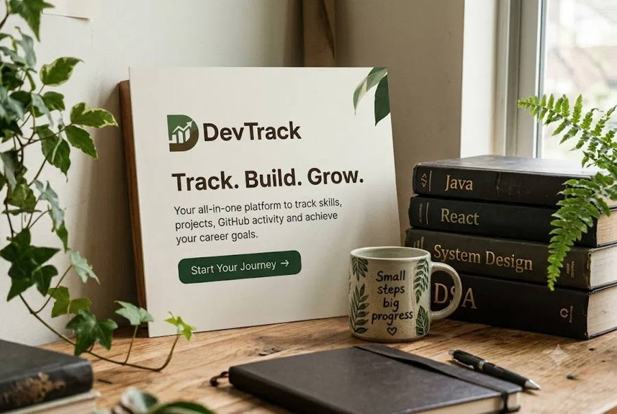

# DevTrack — Developer Career Intelligence & Skills Platform

> 🚀 **Live Demo**: [https://devtrack0.netlify.app](https://devtrack0.netlify.app)

<p align="center">
  
</p>

<p align="center">
  <b>Measure developer competencies, calculate realistic job readiness, and follow an adaptive, milestone-driven career roadmap.</b>
</p>

<p align="center">
  
  
  
  
  
  
</p>

---

## 📖 Overview

**DevTrack** is a modern career readiness and skill acceleration platform engineered for software developers, computer science students, and career switchers. Rather than relying on unstructured tutorials or vague checklists, DevTrack provides a deterministic, data-driven readiness framework:

1. **Target Calibration**: Choose from **28 software engineering roles** across 6 domains, benchmark against **45 target companies** (Big Tech, Indian Unicorns, IT Services, and High-Growth Startups), and define your study schedule.
2. **Diagnostic Competency Tracking**: Audit progress across 11 computer science and software engineering domains and 76 curated competency topics.
3. **Deterministic Readiness Engine**: Calculates real-time role readiness percentage, pace-adjusted remaining study hours, and targeted job-ready completion dates.
4. **Adaptive Milestone Roadmap**: Auto-generates a phased, week-by-week study roadmap with interleaved portfolio projects and interview preparation checkpoints.
5. **Interactive Showcase & AI Mentor**: Includes an animated 30-second product tour and a context-aware AI career mentor informed by your active goals and completed topics.

---

## 🎨 Craftsmanship & Visual Design System

DevTrack features a distinctive, high-taste visual design built with custom CSS tokens:

- **Color Palette**:
  - **Cream Canvas (`#efe6d4`)**: Warm, low-fatigue primary background across all logged-in workspace views.
  - **Rust Accent (`#b4561f`)**: Primary interaction token for call-to-actions, progress fills, badges, and focus indicators.
  - **Dark Brown (`#3f1f12`)**: High-contrast anchor color for floating command rails, hero cards, and the 4-column footer.
  - **Verdigris Green Band (`#264a3a`)**: Editorial section band highlighting target engineering roles and completion states.
  - **Warm Ivory (`#fbf7ee` / `#fbf6ea`)**: Card and surface background token with restrained, organic shadows.
- **Typography**:
  - **Headlines & Display**: Google Font **Gloock** (with **Ghilbe** and **Fraunces** fallbacks) for high-contrast display serif typography on the marketing landing page and stat numbers.
  - **App Workspace**: **Space Grotesk** and **IBM Plex Sans** (with **Instrument Sans** fallback) for precise, readable developer dashboards, tables, and command rail labels.
- **Floating Command Rail Sidebar**:
  - Floating, rounded navigation rail that expands on hover or keyboard focus (76px collapsed to 322px expanded), smoothly shifting adjacent content via sibling selectors.
  - Features an inverted-radius cutout tab joining effect in the cream background color (`#efe6d4`), a pin/unpin toggle button with state persisted to `localStorage`, and collapses into an accessible mobile bottom dock with safe-area inset support on screens $\le 1000\text{px}$.
- **Animated 30-Second Product Tour**:
  - An interactive, tabbed showcase on the landing page simulating live platform workflows (Target calibration, Skill audit, Roadmap pacing, What-if readiness testing, Job tracking, and AI mentor guidance) with live count-up metrics.
- **Responsive Layout**:
  - Fully responsive across desktop (1920×1080), laptop (1366×768), tablet (768px), and mobile viewports (down to 360px) with minimum 44×44px tap targets and zero sideways scrolling.

---

## 🎯 Supported Roles & Target Companies

### 28 Engineering Roles Across 6 Domains (`src/app/data/roles.data.ts`)

| Domain | Roles Included |
|---|---|
| **Web Development** (8) | Frontend Developer, Backend Developer, Full-Stack Web Developer, Angular Developer, React Developer, Python Developer, Java Backend Developer, .NET Developer |
| **Mobile Development** (3) | Android Developer, iOS Developer, Cross-Platform Mobile Developer (Flutter / React Native) |
| **Data, AI & Machine Learning** (6) | AI / ML Engineer, Data Scientist, Data Engineer, Data Analyst, MLOps Engineer, Generative AI Engineer |
| **Cloud, DevOps & Infrastructure** (4) | DevOps / Cloud Engineer, Site Reliability Engineer (SRE), Cloud Architect, Database Administrator (DBA) |
| **Cybersecurity & Systems** (3) | Cybersecurity Analyst, Penetration Tester, Embedded Systems Engineer |
| **Software Engineering & Specialized** (4) | Software Engineer (SDE), QA / Test Automation Engineer, Game Developer, Blockchain Developer |

### 45 Target Companies & Presets Across 4 Tiers

- **Global Product & Big Tech** (19): Google, Microsoft, Amazon, Meta, Apple, Netflix, Adobe, Atlassian, Uber, Stripe, Nvidia, Salesforce, Oracle, SAP, Intel, Qualcomm, Walmart Global Tech, Goldman Sachs, JPMorgan Chase.
- **Indian Product & Unicorns** (13): Zoho, Freshworks, Razorpay, Flipkart, Swiggy, Zomato, PhonePe, Paytm, CRED, Meesho, Groww, Postman, BrowserStack.
- **Service & Consulting** (9): TCS, Infosys, Wipro, HCLTech, Cognizant, Accenture, Capgemini, Tech Mahindra, LTIMindtree.
- **Startups & Custom** (4): Early-stage Startup, Seed / Series-A Startup, Y Combinator Startup, Other / Custom Company.

---

## 🛠️ Architecture & Backend Services

| Layer | Implementation | Details |
|---|---|---|
| **Frontend Framework** | **Angular 19** | Standalone components, `ChangeDetectionStrategy.OnPush`, Native control flow (`@if`, `@for`, `@switch`) |
| **Reactivity** | **Angular Signals** | `signal()`, `computed()`, fine-grained reactive state without RxJS boilerplate |
| **Production Database & Auth** | **Supabase (PostgreSQL)** | Supabase Auth (JWT bearer sessions) + PostgreSQL database with strict **Row-Level Security (RLS)** policies guaranteeing per-user data isolation |
| **Local Development API** | **Node.js + Express** | Optional legacy local backend (`server/index.js`) providing mock endpoints and atomic JSON file persistence |
| **Deployment & CDN** | **Netlify** | Continuous deployment from GitHub with client-side SPA redirect routing |

> **Note on Backend**: In production (and when configured with Supabase credentials), DevTrack communicates directly with **Supabase Auth and PostgreSQL** through `@supabase/supabase-js`. The Express server located in `server/` is a legacy local fallback.

---

## 🚀 Getting Started

### Prerequisites
- **Node.js**: v18.19.0 or higher (v20+ recommended)
- **npm**: v9+ (bundled with Node)

### 1. Clone & Install
```bash
git clone https://github.com/NainaKar/Devtrack.git
cd Devtrack
npm install
```

### 2. Configure Environment (Supabase)
DevTrack is pre-configured to communicate with Supabase. To connect your own Supabase project:
1. Create a project at [supabase.com](https://supabase.com).
2. Execute the database script in `supabase/schema.sql` via the Supabase SQL Editor (creates tables and RLS security policies).
3. Update `src/environments/environment.ts` (and `environment.development.ts`):
```typescript
export const environment = {
  production: false,
  supabaseUrl: 'https://your-project.supabase.co',
  supabaseAnonKey: 'sb_publishable_your_anon_key',
};
```

### 3. Run the Development Server
```bash
npm start
```
`npm start` utilizes `concurrently` to spin up both the local Express fallback server and the Angular live-reload server:
- **Angular Web Client**: [http://localhost:4200](http://localhost:4200) (configured with proxy forwarding)
- **Express Local API**: [http://localhost:3000](http://localhost:3000)

Alternatively, to run only the Angular development client:
```bash
npm run dev
# or: npx ng serve
```

---

## 🌐 Production Build & Deployment

DevTrack is configured for static hosting on **Netlify** with single-page application (SPA) routing:

### 1. Build the Production Bundle
```bash
npm run build
# or: npx ng build
```
- Compiles optimized JavaScript/CSS bundles into the publish directory:
  ```text
  dist/devtrack/browser
  ```

### 2. Single-Page Application (SPA) Routing
The `public/_redirects` file is copied to the root of the publish directory during compilation:
```text
/*    /index.html   200
```
This ensures all deep links (`/app/dashboard`, `/app/skills`, `/about`, `/login`, etc.) correctly route to `index.html` without 404 errors on browser refresh.

### 3. Continuous Deployment via Netlify
- Connect your GitHub repository (`NainaKar/Devtrack`) in the Netlify Dashboard.
- **Build command**: `npm run build`
- **Publish directory**: `dist/devtrack/browser` (or `dist/devtrack` depending on Angular CLI output path)
- Pushing to branch `main` automatically triggers a zero-downtime deployment.

---

## 📐 The Readiness Algorithm (`src/app/engine.ts`)

The readiness calculation is purely functional and mathematically deterministic:

1. **Category Weighting**:
   $$\text{Coverage}_c = \min\left(1.0, \frac{\text{Completed Topics}_c}{\lceil \text{Weight}_{r,c} \times \text{Total Topics}_c \rceil}\right)$$
2. **Formula-Driven Readiness**:
   $$\text{Readiness} = 85\% \times \text{Weighted Skill Coverage} + 15\% \times \left(\frac{\text{Completed Projects}}{\text{Target Projects}}\right)$$
3. **Pace Factor & Study Hours Forecast**:
   $$\text{Adjusted Hours} = \sum (\text{Unfinished Required Topic Hours}) \times \text{Pace Factor} + (\text{Projects Left} \times 15\text{h} \times \text{Pace Factor})$$
   *(Beginner: 1.25×, Intermediate: 1.0×, Advanced: 0.8×)*
4. **Estimated Completion Date (ETA)**:
   $$\text{Estimated Weeks} = \frac{\text{Adjusted Hours}}{\text{Weekly Study Availability (hrs)}}$$
   A user is flagged as "On Track" when $\frac{\text{Estimated Weeks}}{4.345} \le \text{Target Timeline in Months}$.

---

## 📄 License

This project is licensed under the **MIT License** — see the [LICENSE](LICENSE) file for details.

- **Author**: Naina Kar
- **Project**: DevTrack Developer Competency & Career Intelligence Platform
